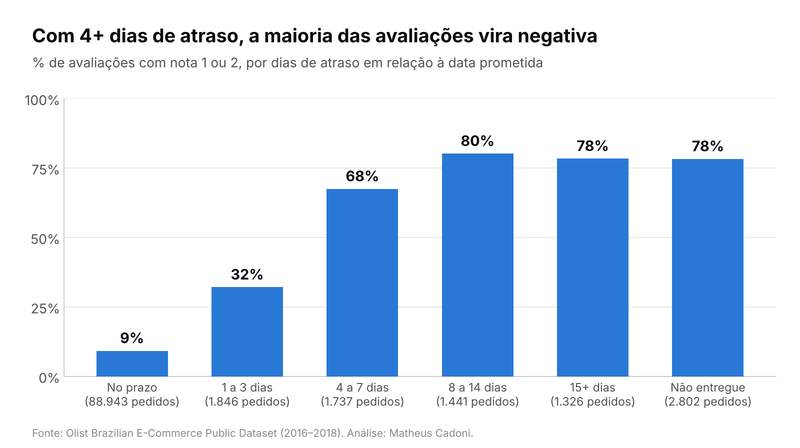
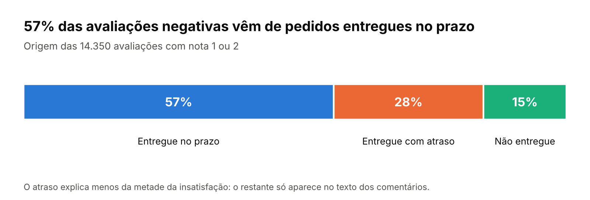
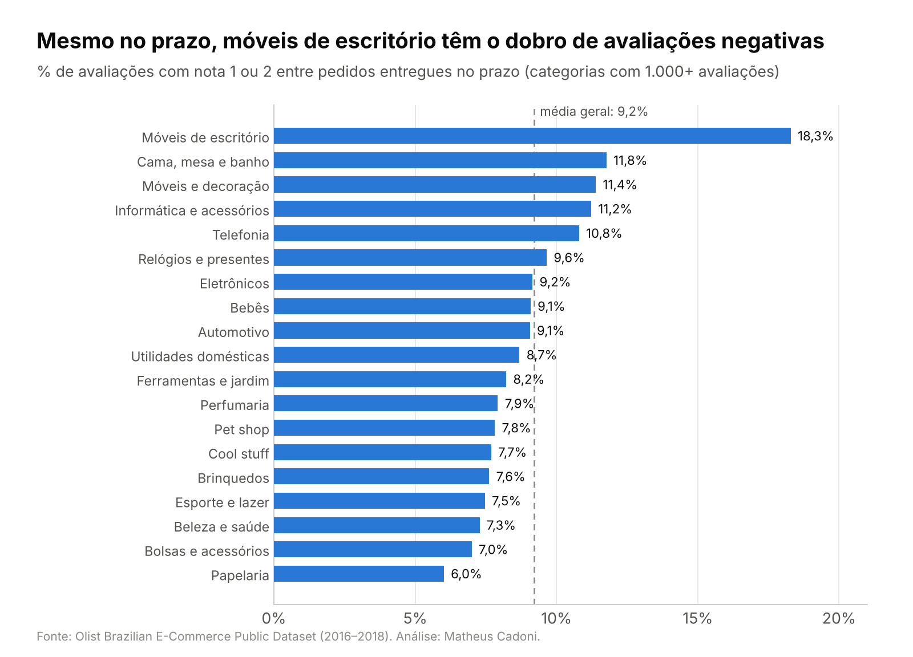
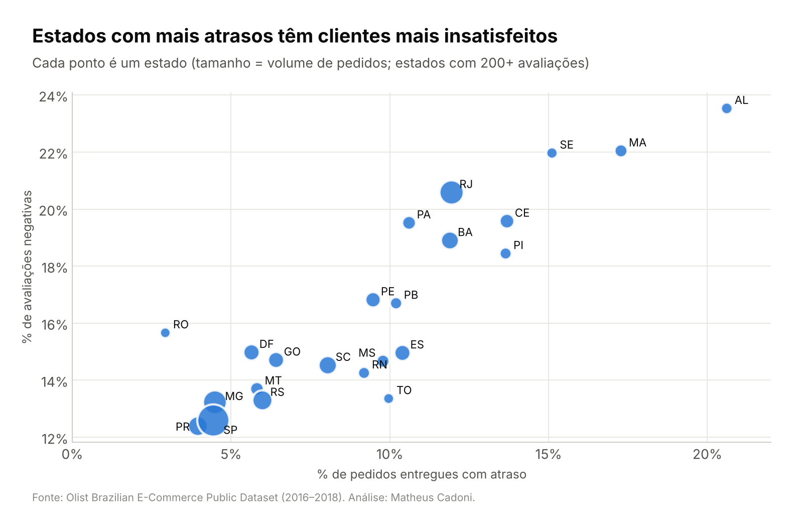
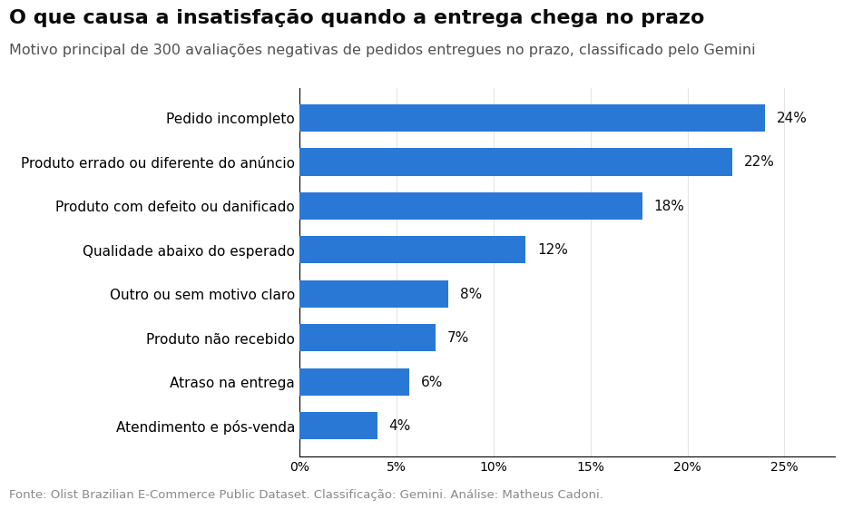

# 🛒 O que explica a insatisfação dos clientes? Análise de avaliações Olist com IA generativa


Análise de cerca de **98 mil avaliações** de clientes do e-commerce Olist para responder a uma pergunta de negócio:
**o que leva um cliente a dar nota 1 ou 2 para uma compra?**

O projeto tem duas etapas:
1. **Análise exploratória:** cruza a nota com atraso na entrega, categoria do produto e estado do cliente.
2. **Classificação com IA generativa:** usa o Google Gemini para ler os comentários negativos e identificar o motivo
   principal de cada reclamação.

> Este projeto complementa o [NPS Preditivo em E-commerce](https://github.com/Matheus074/NPS-Preditivo-em-E-commerce):
> lá o foco é prever **quem** vai ficar insatisfeito; aqui, entender **por quê**.

## ⚡ Em resumo

- O atraso é o maior gatilho isolado: com 4+ dias de atraso, mais de dois terços das avaliações são negativas.
- Mas **57% das avaliações negativas vêm de pedidos entregues no prazo**.
- Lendo esses comentários com IA, a causa aparece: **76% são falhas de produto ou de separação do pedido**
  (pedido incompleto, produto errado, defeito, qualidade), e não de logística.

## 💡 Principais achados

### 1. Com 4 ou mais dias de atraso, a maioria das avaliações vira negativa



Pedidos entregues no prazo têm **9%** de avaliações negativas. Com 1 a 3 dias de atraso, a taxa sobe para **32%**; a
partir de 4 dias, passa de **dois terços**.

### 2. Mas 57% das avaliações negativas vêm de pedidos entregues no prazo



**Este é o achado central.** O atraso explica menos da metade da insatisfação. Para entender o restante, é preciso
ler o que os clientes escreveram, e é aí que entra a etapa com IA.

### 3. Mesmo no prazo, algumas categorias concentram insatisfação



Entre pedidos entregues no prazo, **móveis de escritório** têm 18% de avaliações negativas, o dobro da média,
indicando problemas de produto, montagem ou expectativa.

### 4. Estados com mais atrasos têm clientes mais insatisfeitos



A correlação entre a taxa de atraso e a de avaliações negativas por estado é de **0,88**. Alagoas, Maranhão e
Sergipe lideram nos dois indicadores; SP, PR e MG ficam no extremo oposto.

## 🤖 Classificação dos comentários com Gemini

O notebook [`02_classificacao_gemini.ipynb`](notebooks/02_classificacao_gemini.ipynb) envia uma amostra
estratificada de 600 comentários negativos (300 de pedidos no prazo, 150 com atraso e 150 não entregues) para o
Gemini, que escolhe **um motivo principal** em uma lista fechada:

| Motivo | O que entra aqui |
|---|---|
| Atraso na entrega | O produto chegou, mas depois do esperado |
| Produto não recebido | O cliente diz que o produto não chegou |
| Pedido incompleto | Chegou só parte dos itens ou faltou alguma peça |
| Produto errado ou diferente do anúncio | Outro produto, cor, tamanho, modelo ou marca |
| Produto com defeito ou danificado | Quebrado, não funciona, avariado no transporte |
| Qualidade abaixo do esperado | Chegou certo, mas o material ou acabamento decepcionou |
| Atendimento e pós-venda | Dificuldade de contato, troca, devolução ou reembolso |
| Outro ou sem motivo claro | O texto não permite identificar o motivo |

**Boas práticas aplicadas**
- **Saída estruturada:** a resposta vem em JSON validado por um esquema Pydantic, sem interpretar texto livre.
- **Processamento em lotes** de 30 comentários, com pausa entre chamadas para respeitar o limite do plano gratuito.
- **Retomada automática:** o progresso é salvo a cada lote; se a cota acabar, a execução continua de onde parou.
- **Chave da API protegida** nos *Secrets* do Colab, nunca no código.
- **Conferência manual** de uma amostra das classificações antes de tirar conclusões.

### Resultados



**% de cada motivo dentro de cada grupo** (600 comentários classificados pelo Gemini):

| Motivo | No prazo | Com atraso | Não entregue |
|---|---:|---:|---:|
| Pedido incompleto | **24%** | 0% | 2% |
| Produto errado ou diferente do anúncio | **22%** | 2% | 0% |
| Produto com defeito ou danificado | **18%** | 0% | 1% |
| Qualidade abaixo do esperado | **12%** | 0% | 0% |
| Outro ou sem motivo claro | 8% | 9% | 6% |
| Produto não recebido | 7% | **61%** | **45%** |
| Atraso na entrega | 6% | 23% | 16% |
| Atendimento e pós-venda | 4% | 6% | **31%** |

**O que os comentários revelam**
- **Quando a entrega chega no prazo, o problema é o produto ou a separação do pedido, não a logística.** Pedido
  incompleto, produto errado, defeito e qualidade somam **76%** das reclamações desse grupo. Como ele responde
  por 57% das avaliações negativas, essas falhas explicam, em estimativa, **cerca de 4 em cada 10 avaliações
  negativas** da base.
- **"Pedido incompleto" é o motivo nº 1 no prazo:** os comentários indicam pedidos com vários itens que chegam
  separados, com o cliente avaliando antes de receber tudo.
- **Em pedidos atrasados, 61% dos clientes ainda não receberam o produto** quando avaliam: a Olist envia a
  pesquisa na data prevista de entrega, e o cliente avalia a espera.
- **Em pedidos não entregues, o atendimento pesa (31%):** cancelamentos sem aviso, falta de resposta e produto fora
  de estoque.

**Recomendações:** reforçar a conferência dos itens antes do envio, revisar anúncios com muitas reclamações de
"produto diferente", avisar o cliente sobre entregas parciais e só enviar a pesquisa de satisfação após a entrega
completa.

**Validação:** 25 classificações conferidas manualmente, com 24 corretas e 1 discutível (cerca de 96% de acerto).
*Limitações:* amostra de 600 comentários (margem de erro de cerca de ±6 p.p. no grupo "no prazo"); considera apenas
avaliações negativas com comentário escrito.

## 📁 Estrutura

```
.
├── notebooks/
│   ├── 01_analise_exploratoria.ipynb   # Análise exploratória (com resultados)
│   └── 02_classificacao_gemini.ipynb   # Classificação dos comentários com Gemini (com resultados)
├── img/                                # Gráficos gerados pelos notebooks
├── dados/                              # Coloque aqui os CSVs do Kaggle (não versionados)
└── requirements.txt
```

## 🚀 Como executar

1. Baixe o [Brazilian E-Commerce Public Dataset by Olist](https://www.kaggle.com/datasets/olistbr/brazilian-ecommerce)
   e coloque os arquivos `.csv` na pasta `dados/`.
2. Instale as dependências: `pip install -r requirements.txt`
3. Rode `notebooks/01_analise_exploratoria.ipynb`.
4. Para a etapa com IA, abra `notebooks/02_classificacao_gemini.ipynb` no Google Colab, salve sua chave do
   [Google AI Studio](https://aistudio.google.com/apikey) nos *Secrets* com o nome `key_gemini` e execute.

## 📚 Dados

[Brazilian E-Commerce Public Dataset by Olist](https://www.kaggle.com/datasets/olistbr/brazilian-ecommerce): cerca de
100 mil pedidos reais (anonimizados) feitos entre 2016 e 2018, disponibilizados pela Olist sob licença
CC BY-NC-SA 4.0. Os dados não são versionados neste repositório.

## 👤 Autor

**Matheus Cadoni** · Analista de Dados · [LinkedIn](https://www.linkedin.com/in/matheus-cadoni-aab94a208) · [GitHub](https://github.com/Matheus074)
